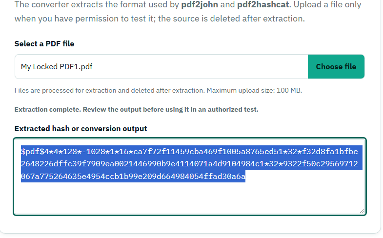
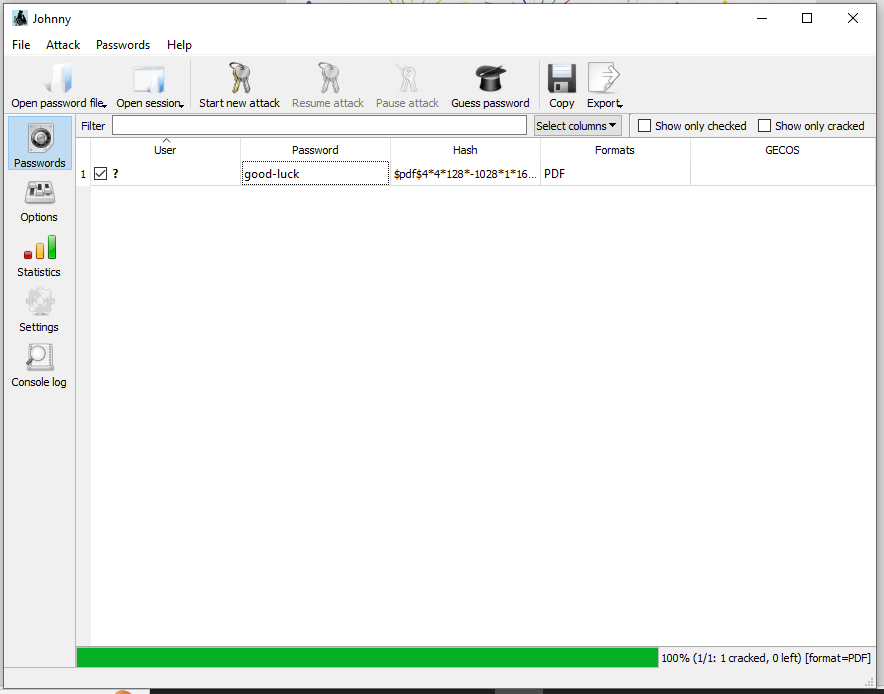
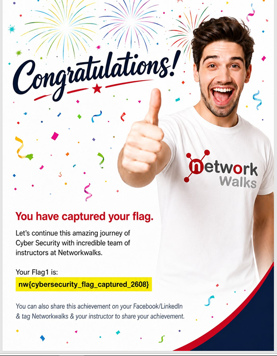
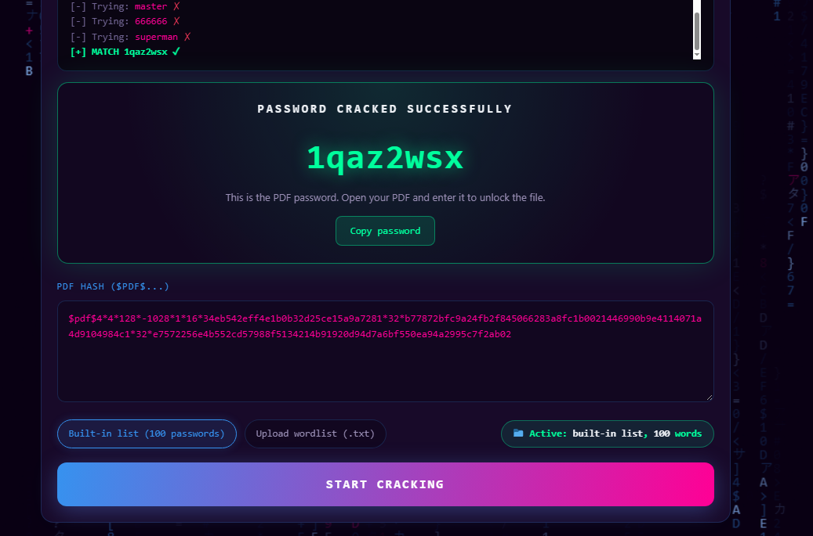
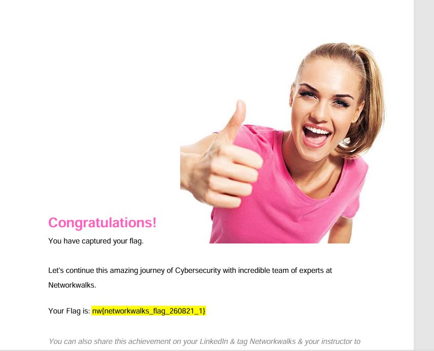

# PDF-PASSWORD-CRACKING-

# Disclaimer
-Only tested on a PDF I had permission to use, as part of an internship exercise. For learning purposes only — don't try this on files or systems you don't own or have written permission to test.

# What I did
-Pulled the password hash out of a locked PDF using a pdf2john-style tool.
-Cracked it offline with John the Ripper (Johnny GUI).
-Cross-checked the method with Networkwalks' own online cracker.

# The process
A locked PDF stores an encrypted version of its password in the file metadata. I extracted that as a $pdf$... hash:

-$pdf$4*4*128*-1028*1*16*...

Loaded into Johnny, a quick dictionary attack cracked it:

-Result: good-luck

I also ran a similar hash through Networkwalks' web-based cracker (100-word built-in list) to confirm the method:

-Result: 1qaz2wsx

(Different sample files were used for each tool, hence the two different passwords — same method both times: extract hash → wordlist attack → plaintext password.)

# Evidence
## under John the Ripper

## under networkwalks tools

# Takeaways
-A locked PDF is only as strong as its password — once you've got the hash, weak passwords fall in seconds.
-Both cracked passwords (good-luck, 1qaz2wsx) are common, predictable choices — exactly what a small wordlist catches first.
-This runs entirely offline against a copy of the file, so controlling who gets that copy matters as much as the password itself.

# Recommendations
-Use long, random passphrases — not real words or keyboard patterns.
-Limit who has access to sensitive encrypted files.
-Don't rely on a password alone; pair it with access controls like restricted sharing or expiring links.

